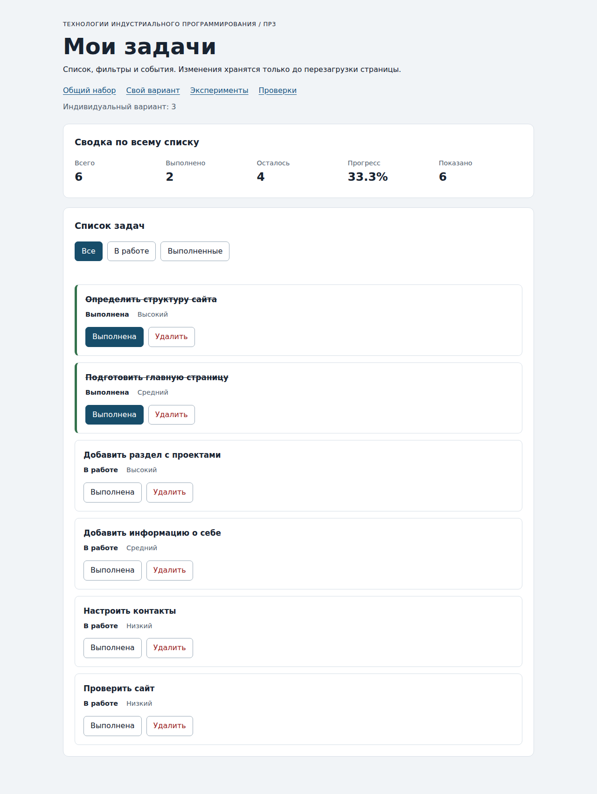

# Практическая работа №3. Работа с DOM и событиями

**Студент:** Алешин Андрей Романович  
**Группа:** ЭФБО-12-25  
**Вариант:** 3 — создание сайта-портфолио.

[Пояснение для защиты](./DEFENSE.md) · [Исходная методичка](https://github.com/adyshkins/TIP-JS/tree/37fd64e6f09e728e60e6304d50eda07c398bbd1c/practices/practice-03)

## 1. Результат и окружение

Реализован список задач с переключением статуса, удалением, тремя фильтрами, общей сводкой и сообщениями. Взяты готовые HTML, CSS, сервер и проверки из стартового комплекта преподавателя. Дополнительные зависимости приложения отсутствуют.

Фактическая проверка этой версии выполнена в Linux x64, Node.js v24.19.0, Chromium 153.0.8010.0. Браузерные сценарии, клавиатурные действия и точки останова воспроизведены в тестовом браузере автоматически; значения отладчика получены через Chrome DevTools Protocol. Версии окружения Mac из прежних работ не выдаются за окружение этого запуска.

## 2. Запуск на Mac

Из корня личного репозитория:

```bash
cd practice-03
npm run check:service
npm start
```

Установка `npm install` не требуется. Открыть в браузере:

- Приложение: `http://127.0.0.1:5503/`
- Вариант №3: `http://127.0.0.1:5503/index.html?dataset=variant`
- Эксперименты: `http://127.0.0.1:5503/examples/dom-events.html`
- Проверки: `http://127.0.0.1:5503/checks.html`

Терминал с сервером остаётся работающим. Остановка — Ctrl+C. Если порт занят: `node tools/serve.mjs 5504`, затем использовать 5504 в адресе. Прямое открытие HTML через `file://` не используется из-за загрузки ES-модулей. Изменения задач хранятся только до перезагрузки.

## 3. Что перенесено из ПР2

`src/task-service.js` и `src/data.js` скопированы из собственной ПР2 без изменения функций и наборов. Повторные 35 проверок сервиса прошли. Сервис не обращается к DOM. Общий набор `[1,4,7,10]` и индивидуальный `[11,23,37,41,58,64]` используются отдельно. ПР1 и ПР2 остаются самостоятельными работами.

## 4. Эксперименты с DOM и событиями

Ожидания сформулированы по коду примера перед запуском; наблюдения получены на `examples/dom-events.html`.

| № | Прогноз | Фактический результат | Объяснение |
|---:|---|---|---|
| 1 | Отсутствующий элемент — null, коллекция — длина 0. | null; 0. | querySelector возвращает один элемент или null, querySelectorAll — коллекцию. |
| 2 | dataset.taskId — строка «23», после Number — число 23. | «23», string; 23, number. | data-атрибуты содержат строки. |
| 3 | После двух добавлений старый NodeList — 1, новый запрос — 3. | Старый: 1 и 1; новый: 2 и 3. | Сохранённый NodeList статический. |
| 4 | Строка с strong выводится буквально. | `<strong>Это текст, а не HTML</strong>`; дочерних элементов 0. | textContent не разбирает HTML. |
| 5 | Захват контейнера, всплытие через кнопку, всплытие контейнера. | Фазы 1, 3, 3; target всегда lab-label. | Нажатие выполнено по вложенному span, поэтому кнопка — его предок. |

Журнал пятого эксперимента:

```text
1. phase=1; target=lab-label; currentTarget=lab-card
2. phase=3; target=lab-label; currentTarget=lab-button
3. phase=3; target=lab-label; currentTarget=lab-card
```

В обработчике кнопки точка останова на строке 26 `examples/dom-events.js` подтвердила `target.id = lab-label`, `currentTarget.id = lab-button`, `eventPhase = 3`.

## 5. Организация решения

- `task-service.js` — функции ПР2, работающие с массивом задач.
- `task-selectors.js` — новый массив видимых задач через filter или копирование.
- `task-view.js` — создание элементов через createElement, текст через textContent, обновление списка через replaceChildren; сводка через getTaskStats.
- `main.js` — полный `currentTasks`, отдельный `currentFilter`, два делегированных обработчика и renderApp.

После успешной операции сохраняется `result.tasks`, затем обновляется весь интерфейс. При отказе выводится error, данные остаются прежними. Обработчики назначены один раз контейнерам. Кнопки находятся через closest, id преобразуется через Number и проверяется как положительное безопасное целое. Статус берётся из текущего массива. Клавиатурный фокус восстанавливает готовая функция restoreTaskFocus.

## 6. Общий сценарий

Контрольные ожидания: последовательно общий прогресс 50.0%, 50.0%, 75.0%, 75.0%, 100.0%, 100.0%, 66.7%, 0.0%. На шаге 5 ожидается отсутствие совпадений фильтра, на шаге 7 — полностью пустой список. Ниже фактические наблюдения:

| Шаг / действие | Видимые id | Всего | Выполнено | Осталось | Прогресс | Показано | Сообщение | Итог |
|---|---|---:|---:|---:|---:|---:|---|---|
| 0. Исходный набор, «Все» | `[1, 4, 7, 10]` | 4 | 2 | 2 | 50.0% | 4 | — | Совпало |
| 1. Фильтр «В работе» | `[4, 7]` | 4 | 2 | 2 | 50.0% | 2 | — | Совпало |
| 2. Выполнить id=4 | `[7]` | 4 | 3 | 1 | 75.0% | 1 | — | Совпало |
| 3. Фильтр «Все» | `[1, 4, 7, 10]` | 4 | 3 | 1 | 75.0% | 4 | — | Совпало |
| 4. Удалить id=7 | `[1, 4, 10]` | 3 | 3 | 0 | 100.0% | 3 | — | Совпало |
| 5. Фильтр «В работе» | `[]` | 3 | 3 | 0 | 100.0% | 0 | Нет задач по выбранному фильтру. | Совпало |
| 6. «Все», переключить id=1 | `[1, 4, 10]` | 3 | 2 | 1 | 66.7% | 3 | — | Совпало |
| 7. Удалить 1, 4, 10 | `[]` | 0 | 0 | 0 | 0.0% | 0 | Список задач пуст. | Совпало |

После перезагрузки вернулись `[1,4,7,10]`, сводка 4/2/2/50.0%, показано 4. Это ожидаемое поведение ПР3.

## 7. Индивидуальный вариант №3

Тема — создание сайта-портфолио. Исходные задачи:

| id | Название | Выполнена | Приоритет |
|---:|---|---|---|
| 11 | Определить структуру сайта | Да | high |
| 23 | Подготовить главную страницу | Да | medium |
| 37 | Добавить раздел с проектами | Нет | high |
| 41 | Добавить информацию о себе | Нет | medium |
| 58 | Настроить контакты | Нет | low |
| 64 | Проверить сайт | Нет | low |

До действий фильтр «В работе» показал `[37,41,58,64]`, «Выполненные» — `[11,23]`, «Все» — все шесть записей. Ожидание после переключения 23: одна выполненная из шести, 16.7%. После удаления невыполненной 37: одна выполненная из пяти, 20.0%. Фактический результат:

| Шаг / действие | Видимые id | Всего | Выполнено | Осталось | Прогресс | Показано | Сообщение | Итог |
|---|---|---:|---:|---:|---:|---:|---|---|
| 0. Исходное состояние, «Все» | `[11, 23, 37, 41, 58, 64]` | 6 | 2 | 4 | 33.3% | 6 | — | Совпало |
| 1. Переключить id=23 | `[11, 23, 37, 41, 58, 64]` | 6 | 1 | 5 | 16.7% | 6 | — | Совпало |
| 2. Удалить id=37 | `[11, 23, 41, 58, 64]` | 5 | 1 | 4 | 20.0% | 5 | — | Совпало |
| 3. Итог: «В работе» | `[23, 41, 58, 64]` | 5 | 1 | 4 | 20.0% | 4 | — | Совпало |
| 4. Итог: «Выполненные» | `[11]` | 5 | 1 | 4 | 20.0% | 1 | — | Совпало |

Названия и приоритеты остальных задач сохранены. После этих действий экспортированный `variantTasks` по-прежнему содержит исходные шесть записей.

## 8. Реальный протокол проверки сервиса

Команда: `npm run check:service`. Проверки предоставлены преподавателем, ожидания не изменялись.

```text
> tip-js-practice-03@1.0.0 check:service
> node checks/service.checks.js

OK: 01. Создание задачи с явным приоритетом
OK: 02. Приоритет по умолчанию
OK: 03. Удаление краевых пробелов без изменения внутренних
OK: 04. Граничные длины названия и положительный безопасный id
OK: 05. Некорректные названия при создании
OK: 06. Некорректные идентификаторы при создании
OK: 07. Все допустимые приоритеты и отклонение недопустимых
OK: 08. Каждый вызов createTask возвращает новый объект
OK: 09. Поиск по id, а не по индексу
OK: 10. Отсутствующая задача и пустой массив при поиске
OK: 11. Поиск не преобразует строковый id в число
OK: 12. Получение невыполненных задач
OK: 13. Пустой список, все выполнены и все не выполнены
OK: 14. Названия в исходном порядке и пустой список
OK: 15. Сводка по общему набору
OK: 16. Сводка по пустому списку
OK: 17. Сводка: ничего не выполнено и выполнено всё
OK: 18. Процент остаётся числом без предварительного округления
OK: 19. Добавление в конец без изменения входного массива
OK: 20. Добавление в пустой список с приоритетом по умолчанию
OK: 21. Повторяющийся id отклоняется
OK: 22. Добавление не обходит проверки createTask
OK: 23. Изменение completed в обе стороны
OK: 24. completed принимает только boolean
OK: 25. Некорректный или отсутствующий id при изменении статуса
OK: 26. Повторная установка статуса создаёт новый результат
OK: 27. Переименование сохраняет остальные поля
OK: 28. Проверки названия при переименовании
OK: 29. Некорректный или отсутствующий id при переименовании
OK: 30. Удаление по id с сохранением порядка
OK: 31. Удаление единственной записи
OK: 32. Некорректный, отсутствующий id и удаление из пустого списка
OK: 33. Входные объекты не изменяются ни одной операцией
OK: 34. Общий сценарий и все промежуточные сводки
OK: 35. Работа с другим набором, без зависимости от demoTasks

Проверок пройдено: 35; не пройдено: 0.
```

## 9. Реальный протокол браузерных проверок

Текст получен из `#check-log` страницы `checks.html` после завершения всех сценариев.

```text
OK: Фильтр all возвращает новый массив в исходном порядке
OK: Фильтр pending выбирает невыполненные задачи
OK: Фильтр completed выбирает выполненные задачи
OK: Все три фильтра работают с пустым списком
OK: Фильтрация не меняет входные записи и их порядок
OK: Карточка — li.task-card с числовым id в dataset
OK: Статус невыполненной карточки и aria-pressed согласованы
OK: Статус выполненной карточки и aria-pressed согласованы
OK: В карточке две обычные кнопки с вложенными подписями
OK: Все приоритеты отображаются по установленному словарю
OK: Название с разметкой отображается текстом
OK: Отрисовка списка создаёт карточки в исходном порядке
OK: Повторная отрисовка не накапливает карточки
OK: Контейнер списка и его обработчик сохраняются
OK: Отрисовка пустого массива очищает прежние карточки
OK: Сводка считается по всему списку, отдельно выводится Показано
OK: Пустая сводка не содержит NaN и Infinity
OK: Сообщение для полностью пустого списка
OK: Сообщение для пустого результата фильтра
OK: Появление карточек скрывает прежнее пустое состояние
OK: Приложение: начальный набор и сводка
OK: Приложение: фильтр срабатывает по клику на вложенный span
OK: Приложение: активный фильтр отмечен классом и aria-pressed
OK: Приложение: фильтрация не удаляет скрытые задачи
OK: Приложение: переключение по id, а не индексу массива
OK: Приложение: выполненная задача исчезает из фильтра В работе
OK: Приложение: удаление изменяет данные, а не только DOM
OK: Приложение: клик по названию не изменяет данные
OK: Приложение: после перерисовок одно нажатие — одно изменение
OK: Приложение: удаление всех записей и нулевая сводка
OK: Приложение: нет совпадений — не то же самое, что нет задач
OK: Приложение: неизвестный числовой id не меняет данные
OK: Приложение: id 4abc не превращается в 4
OK: Приложение: неизвестное действие игнорируется
OK: Приложение: после изменения сохраняется клавиатурный фокус
OK: Приложение: новая загрузка возвращает исходное состояние

Всего: 36. Пройдено: 36. Ошибок: 0.
```

## 10. Собственные проверки

| № | Исходное состояние и действия | Ожидание | Фактический результат | Итог |
|---:|---|---|---|---|
| 1 | Карточка с названием из 100 букв «Я». | Полный текст, длина 100, вложенной разметки нет. | Длина 100, children.length=0. | Пройдено |
| 2 | Общий набор; пять переключений фильтров; десять кликов по вложенной подписи toggle у id=4. | Чётное число переключений вернёт начальные статусы. | 4/2/2/50.0%, показано 4. | Пройдено |
| 3 | Оставить только id=4, выбрать pending, выполнить её; затем выбрать all и удалить. | Сначала нет совпадений при total=1, затем пустой список при total=0. | Оба сообщения и счётчики верны. | Пройдено |
| 4 | После варианта переключить 23 и удалить 37, прочитать исходный экспорт. | Исходный массив сохраняется. | 6 задач; 23 выполнена; 37 на месте. | Пройдено |

## 11. Отладка, ошибки и клавиатура

В `src/main.js` поставлены две точки останова. На строке 49, перед Number: `event.target.tagName = SPAN`, `event.currentTarget.id = task-list`, `card.dataset.taskId = "4"`, тип string, действие toggle. На строке 71, после вызова сервиса: `id = 4`, тип number; старый completed=false, `result.ok=true`, в новом массиве completed=true, массив отличается от прежнего. Это подтверждает путь «событие → id → функция ПР2 → новый массив → renderApp».

Отказы проверены подменой data-task-id в DOM, исходный файл не менялся:

| Атрибут | Фактическое сообщение | После выбора «Все» |
|---|---|---|
| `777` | Задача не найдена | Исходные четыре задачи, 50.0%, сообщение очищено. |
| `4abc` | Некорректный идентификатор задачи. | Исходные четыре задачи, 50.0%, сообщение очищено. |

Клавиатура проверена реальными событиями клавиш тестового браузера: Tab прошёл четыре ссылки, три фильтра и попал на статус id=1. Enter снял выполнение, фокус сохранился на новой кнопке этой задачи; Space вернул выполнение. Следующий Tab перешёл на «Удалить», Enter удалил id=1, фокус вернулся на активный фильтр «Все». Дополнительно встроенные проверки подтвердили возврат фокуса на фильтр при исчезновении карточки из видимой выборки.

Дополнительный текстовый протокол: [scenario-checks-output.txt](./scenario-checks-output.txt). Во время проверок необработанных ошибок страницы не было.

## 12. Вид работающего приложения

Снимок получен после запуска собственного решения на индивидуальном наборе.



## 13. Дополнительное задание

Дополнительное расширение не выполнялось. Реализованы все обязательные действия, фильтры, сообщения и индивидуальный вариант.

## 14. Вывод

К функциям второй работы подключён браузерный интерфейс. Данные хранятся отдельно от DOM, а выбранный фильтр не удаляет скрытые записи. Карточки создаются DOM-методами, названия выводятся как текст. Делегирование позволяет обрабатывать вложенные подписи кнопок и повторно создавать карточки без новых подписок. После операций обновляются и список, и общая сводка, и число видимых записей. Реальные проверки подтвердили работу обычного, пустого и ошибочного состояний; сохранение после перезагрузки в ПР3 не предусмотрено.
