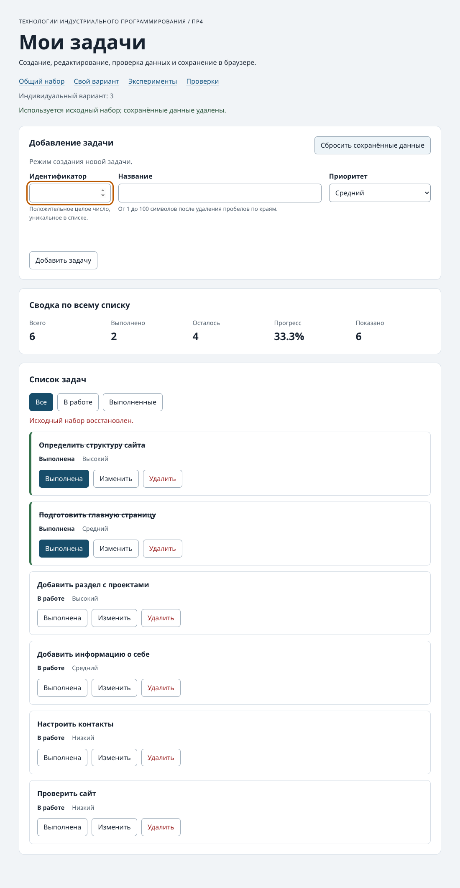

# Практическая работа №4. Формы, валидация и локальное хранение данных

**Студент:** Алешин Андрей Романович
**Группа:** ЭФБО-12-25
**Вариант:** 3, создание сайта-портфолио.

## 1. Результат и окружение

К списку задач из ПР3 добавлены форма создания и редактирования, проверка полей и сохранение в браузере. Проверки выполнены на Debian 13 с Node.js 24.22.1, npm 11.9.0 и Chromium 153.0.8010.0.

## 2. Запуск

Из папки `practice-04`:

```bash
npm test
npm start
```

Зависимостей для установки нет. Адреса при запущенном сервере:

- Общий набор — `http://127.0.0.1:5504/`.
- Вариант 3 — `http://127.0.0.1:5504/?dataset=variant`.
- Эксперименты — `http://127.0.0.1:5504/examples/forms-storage.html`.
- Браузерные проверки — `http://127.0.0.1:5504/checks.html`.

## 3. Что перенесено из ПР3

В `data.js` и `task-selectors.js` сохранены оба набора и фильтры. В `task-service.js` добавлена функция `updateTask`. Она меняет название и приоритет в копии выбранной задачи, сохраняя id и статус. Карточка из `task-view.js` получила третью кнопку «Изменить». Перед добавлением формы перенесённый сервис прошёл 35 проверок.

## 4. Эксперименты с формой и JSON

| Действие | Прогноз | Фактический результат и объяснение |
|---|---|---|
| Отправить пустое обязательное поле | Браузер заблокирует отправку | Журнал остался без изменений, `validity.valid = false`, сообщение `Please fill out this field.`. Событие `submit` ещё не дошло до обработчика. |
| Отправить три пробела | `required` пропустит, прикладная проверка отклонит | `submit` получен. После `trim()` название пустое, `setCustomValidity` установил `customError = true`. |
| Сохранить `"  Макет  "` с приоритетом `low` | Обработчик отменит отправку и уберёт крайние пробелы | `defaultPrevented = true`, название из `FormData` имеет тип `string`, в сохранённом объекте название «Макет». |
| Прочитать сохранение | `getItem` вернёт строку, `JSON.parse` восстановит объект | Прочитано `{"title":"Макет","priority":"low"}`, разобраны оба поля. |
| Записать `{broken-json` и прочитать | `JSON.parse` выбросит исключение | Появилось сообщение об ошибке разбора, страница продолжила работать. |

## 5. Как работает решение

- `form-validation.js` возвращает нормализованные поля или ошибки. При создании id берётся из `FormData` и преобразуется в число. При редактировании отключённое поле id отсутствует в `FormData`, поэтому используется `editingId`.
- `task-storage.js` работает с JSON формата `{ version: 1, tasks }`. При загрузке проверяются версия, поля каждой задачи и уникальность id. Если данные повреждены или недоступны, возвращается копия исходного набора.
- `main.js` связывает форму, операции и отрисовку. Запись в хранилище выполняется после добавления, изменения, переключения статуса или удаления. Выбор фильтра влияет на показ карточек. Сброс удаляет ключ текущего набора через `removeItem`.
- Карточки обновляются через `replaceChildren`, названия выводятся через `textContent`. После переключения статуса фокус возвращается на кнопку карточки, после удаления — на активный фильтр.

| Проверка формы | Ожидаемый результат | Фактический результат |
|---|---|---|
| id `"20"`, название с пробелами по краям | id станет числом, название очистится | `20`, «Изучить localStorage». |
| id занят, пустое название или неверный приоритет | Ошибки у соответствующих полей | Проверки вернули непустые сообщения. При нескольких ошибках вернулись все поля. |
| Редактирование выполненной задачи | Название и приоритет изменятся, статус сохранится | Задача 23 осталась выполненной. |
| Редактирование отсутствующего id | Отказ без изменений | Проверка отклонила id отсутствующей записи. |

## 6. Общий контрольный сценарий

В сводке приведены «всего / выполнено / осталось / прогресс».

| Действие | Ожидание | Фактический результат |
|---|---|---|
| Сбросить данные | id `[1, 4, 7, 10]`, 4 / 2 / 2 / 50.0% | `[1, 4, 7, 10]`, 4 / 2 / 2 / 50.0%. |
| Добавить 20, «Изучить localStorage», высокий | Новый id 20, 5 / 2 / 3 / 40.0% | `[1, 4, 7, 10, 20]`, 5 / 2 / 3 / 40.0%. |
| Попробовать добавить дубликат 4 | Ошибка у поля id, список и JSON сохраняются | «Задача с таким id уже существует», JSON остался тем же. |
| Изменить 4 на «Подготовить форму задач» с низким приоритетом | Название и приоритет обновятся, `completed = false` | Сохранены новое название, `low` и `completed = false`, 5 / 2 / 3 / 40.0%. |
| Завершить 7 клавишей Enter | 5 / 3 / 2 / 60.0%, фокус остаётся на действии | 5 / 3 / 2 / 60.0%, фокус вернулся на кнопку задачи 7. |
| Удалить 1 | id `[4, 7, 10, 20]`, 4 / 2 / 2 / 50.0% | `[4, 7, 10, 20]`, 4 / 2 / 2 / 50.0%. |
| Перезагрузить страницу | Те же id и сводка, сообщение о восстановлении | Восстановились `[4, 7, 10, 20]` и 50.0%. Страница показала «Данные восстановлены из localStorage». |
| Сбросить данные повторно | Исходные id, ключ отсутствует | `[1, 4, 7, 10]`, `getItem("tip-js-practice-04:demo") = null`. |

При значении `{broken-json` в ключе общего набора после перезагрузки показались исходные четыре карточки и предупреждение о чтении. После сброса повреждённый ключ был удалён.

## 7. Индивидуальный вариант 3

| Действие | Ожидание | Фактический результат |
|---|---|---|
| Сбросить набор варианта | Шесть задач ПР3, выполнены 11 и 23 | `[11, 23, 37, 41, 58, 64]`, 6 / 2 / 4 / 33.3%. |
| Добавить 75, «Подобрать обложки проектов», средний | Семь задач, две выполнены | id 75 появился в списке, 7 / 2 / 5 / 28.6%. |
| Изменить 23 на «Доработать главную страницу» с высоким приоритетом | Изменятся два поля, статус сохранится | После перезагрузки сохранены новое название, `high` и `completed = true`. |
| Удалить 37 и перезагрузить страницу | `[11, 23, 41, 58, 64, 75]`, 6 / 2 / 4 / 33.3% | Восстановлены указанные id и 33.3%. |
| Открыть общий набор, затем сбросить вариант | Общий набор остался исходным, у варианта снова шесть исходных задач | Общий набор `[1, 4, 7, 10]`, после сброса варианта `[11, 23, 37, 41, 58, 64]`. |

## 8. Автоматические и собственные проверки

| Набор | Ожидание | Фактически |
|---|---:|---:|
| `npm run check:service` | 35 из 35 | 35 из 35 |
| `npm run check:modules` | 27 из 27 | 27 из 27 |
| `checks.html` | 23 из 23 | 23 из 23 |

Полные результаты доступны в [протоколе Node.js](./node-checks-output.txt) и [браузерном протоколе](./browser-checks-output.txt).

| Собственный сценарий | Ожидание | Фактически |
|---|---|---|
| Из исходного набора добавить id `9007199254740991`, затем `9007199254740992` | Первый id допустим, второй отклонён | Первая карточка появилась, для второго значения показана ошибка допустимого диапазона. Пройдено. |
| Удалить все четыре задачи и обновить страницу | Восстановится сохранённый пустой список | Сводка `0 / 0 / 0 / 0.0%`, сообщение «Список задач пуст». Пройдено. |
| Имитировать `QuotaExceededError` при записи и добавить id 30 | Задача появится в текущем списке, появится предупреждение | id 30 виден, ключ отсутствует, показано «Не удалось сохранить изменения в localStorage». Пройдено. |

## 9. Отладка

В отладчике Chromium поставлены точки останова в `handleFormSubmit` после валидации и после операции сервиса.

| Значение | Что показал отладчик |
|---|---|
| Черновик | `{ id: "20", title: "  Изучить localStorage  ", priority: "high" }` |
| После валидации | `{ ok: true, value: { id: 20, title: "Изучить localStorage", priority: "high" } }` |
| Результат сервиса | `ok: true`, массив из пяти задач с id `[1, 4, 7, 10, 20]`. |
| Запись | Строка JSON с `"version":1` и задачей `{"id":20,"title":"Изучить localStorage","completed":false,"priority":"high"}` в конце массива. |
| Попытка повторного id 4 | `ok: false`, ошибка в `errors.id`. До вызова сервиса выполнение не дошло, сохранённая строка осталась прежней. |



## 10. Вывод

HTML проверяет базовые ограничения, а чистая функция проверяет правила списка, включая повторный id и название после `trim()`. Чтение из `localStorage` требует проверки схемы после `JSON.parse`, потому что синтаксически корректный JSON может содержать неверные задачи.
