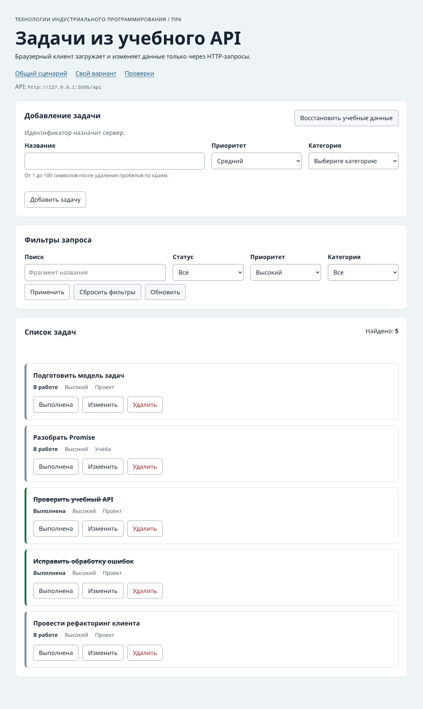

# Практическая работа №6. Подключение браузерного приложения к API

**Студент:** Алешин Андрей Романович
**Группа:** ЭФБО-12-25
**Вариант:** 3, высокий приоритет.

## 1. Цель и результат

Браузерное приложение загружает задачи и категории с учебного сервера. Добавление, редактирование, смена статуса и удаление выполняются через API. Сервер назначает id, а интерфейс после изменения снова запрашивает задачи с текущими фильтрами.

## 2. Окружение и запуск

Проверено на Debian 13, Node.js 24.22.1, npm 11.9.0 и Chromium 153.0.8010.0.

Из папки `practice-06`:

```bash
npm test
npm start
```

`npm start` запускает сайт и учебный API вместе. Порт API должен быть свободен, в том числе после работы с ПР5.

| Что открыть | Адрес |
|---|---|
| Общий набор | `http://127.0.0.1:5506/` |
| Вариант 3 | `http://127.0.0.1:5506/?dataset=variant` |
| Браузерные проверки | `http://127.0.0.1:5506/checks.html` |
| Состояние API | `http://127.0.0.1:5505/api/health` |

## 3. Реализация

- `api-client.js` продолжает клиент ПР5. Метод и тело передаются в `requestJson`. Для тела запроса используется `JSON.stringify` и `Content-Type: application/json`. При 204 возвращается `null`. Тайм-аут, внешняя отмена, сетевая, HTTP-ошибка и неверный формат обрабатываются отдельно.
- `task-api.js` выбирает маршруты, передаёт фильтры и проверяет схему ответов. Создание использует `POST /tasks`, редактирование и статус — `PATCH /tasks/:id`, удаление — `DELETE /tasks/:id`, сброс — `POST /debug/reset`.
- `form-validation.js` очищает название, проверяет приоритет и сверяет числовой id категории со справочником. Ошибки передаются представлению и показываются рядом с полями.
- `task-view.js` строит карточки и выводит значения через `textContent`. Список заменяется через `replaceChildren`. `dom-app.js` связывает кнопки и форму с контроллером.

`app-controller.js` начинает загрузку со состояния `loading`. После ответа со списком устанавливает `ready`, после пустого ответа — `empty`, при ошибке — `error` и показывает кнопку повтора. При первой загрузке задачи и категории запрашиваются параллельно. Если она завершилась ошибкой, повтор запрашивает оба ресурса.

Перед новой загрузкой контроллер отменяет предыдущую и увеличивает номер запроса. Перед выводом он сверяет номер завершившейся загрузки с текущим. Это защищает от старого ответа, даже если тот успел завершиться рядом с моментом отмены. При записи контроллер блокирует кнопки, ждёт подтверждения операции и запускает новый GET.

## 4. Индивидуальный вариант 3

| Шаг | Ожидание | Фактически |
|---|---|---|
| Открыть страницу варианта | `GET /api/tasks?priority=high`, id `[4, 13, 16, 25, 34]` | Отправлен указанный GET, показаны пять ожидаемых задач. |
| В задаче 4 выбрать «Средний» и сохранить | PATCH сохранит `priority: "medium"`, повторный GET применит высокий фильтр | `PATCH /api/tasks/4` вернул средний приоритет. После повторного `GET /api/tasks?priority=high` остались `[13, 16, 25, 34]`. |
| Восстановить учебные данные | Задача 4 снова в высоком фильтре | Показаны исходные пять задач. |



## 5. Автоматические проверки

| Набор | Ожидание | Фактически |
|---|---:|---:|
| `npm run check:api` | 23 из 23 | 23 из 23 |
| `npm run check:modules` | 33 из 33 | 33 из 33 |
| `npm run check:integration` | 14 из 14 | 14 из 14 |
| `checks.html` | 14 из 14 | 14 из 14 |

В проверке создания задачи поиск карточки id 35 теперь возвращает `null` во время ожидания ответа сервера. После появления карточки по-прежнему проверяются её id, название, очистка формы и счётчик.

[Протокол Node.js](./node-checks-output.txt) и [браузерный протокол](./browser-checks-output.txt).

## 6. Браузерные сценарии

| № | Действие | Ожидание | Фактически |
|---:|---|---|---|
| 1 | Открыть приложение при остановленном API | `error` и кнопка повтора | Показано сообщение «Нет соединения с учебным API» и кнопка «Повторить загрузку». |
| 2 | Запустить API и нажать повтор | Появятся задачи и категории | 12 задач и три категории, состояние `ready`. |
| 3 | Найти отсутствующую задачу | `empty`, счётчик 0 | «По выбранным условиям задач нет», счётчик 0. |
| 4 | Отправить название из пробелов | Ошибка поля, запрос записи отсутствует | Показано требование длины, новых запросов к API не было. |
| 5 | Создать «Проверка браузера» и перезагрузить страницу | 201 и серверный id, задача сохранится | 201, id 35, карточка осталась после перезагрузки. |
| 6 | Изменить выполненную задачу 1 | Новые поля, прежний статус | PATCH вернул 200, название «Изучить функции подробнее», категория 3 и `completed: true`. |
| 7 | Завершить задачу 4 под фильтром «В работе» клавишей Enter | Повторный GET уберёт завершённую задачу из выборки | `PATCH` вернул `completed: true`, после `GET ?completed=false` карточки 4 нет. |
| 8 | Отменить удаление задачи 7 | Задача останется, DELETE отсутствует | Карточка 7 видна, DELETE не отправлен. |
| 9 | При задержке сети 350 мс быстро применить поиск «модель», затем «учебный» | Останется только результат последнего запроса | Первый запрос прервался с `net::ERR_ABORTED`, в списке только задача 16. |
| 10 | Сбросить фильтры и восстановить данные | Вернутся 12 исходных задач | `[1, 4, 7, 10, 13, 16, 19, 22, 25, 28, 31, 34]`. |

## 7. Контрольные вопросы

1. HTTP 404 и 500 означают, что сервер ответил. `fetch` возвращает `Response`, а код проверяет `response.ok`.
2. Сначала проверяется `response.ok`, затем обрабатывается 204, потом проверяются `Content-Type` и разбор JSON.
3. POST создаёт задачу с серверным id. PATCH обновляет только переданные поля существующей задачи.
4. 201 сообщает об успешном создании. `Location` указывает адрес новой записи.
5. Ответ 204 содержит пустое тело. Вызов `json()` для него дал бы ошибку разбора.
6. Перед междоменным PATCH или запросом с JSON браузер может отправить OPTIONS. `no-cors` не даёт приложению прочитать ответ такого запроса.
7. `empty` — успешный запрос без совпадений. `error` — загрузка не состоялась, доступна кнопка повтора.
8. Сервер хранит актуальные записи для всех вкладок. Браузер получает их через GET.
9. Повторная загрузка учитывает серверный id, новые значения и действующие фильтры.
10. Первый из двух запросов может завершиться последним и перерисовать список устаревшей выборкой.
11. Ответ может успеть завершиться до обработки отмены. Номер загрузки позволяет игнорировать его результат.
12. Отмена при смене фильтра — часть обычной работы интерфейса. Пользователю показывается состояние текущего запроса.
13. Клиент проверяет поля для понятных подсказок. Сервер снова проверяет тело, допустимые значения и существование категории.
14. Через объект `view` контроллер работает с разными представлениями. В тесте можно передать имитацию без браузера.
15. `textContent` вставляет строку как текст и не создаёт из неё HTML-элементы.

## 8. Вывод

Для интерфейса, работающего через API, нужно отдельно обрабатывать ожидание, пустую выборку и ошибку. После успешной операции приложение запрашивает актуальное состояние. При быстрой смене фильтров результат определяется последней загрузкой.
