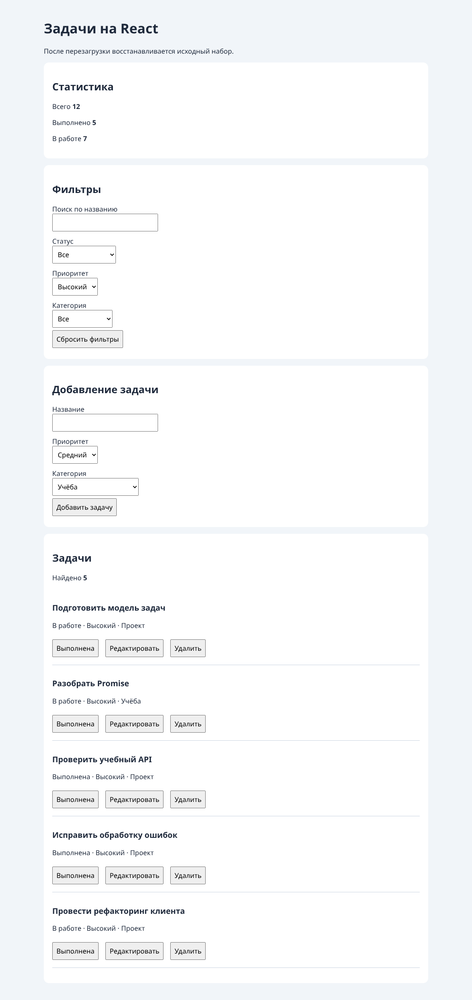

# Практическая работа №7. Создание компонентного интерфейса на React

**Студент:** Алешин Андрей Романович
**Группа:** ЭФБО-12-25
**Вариант:** 3, высокий приоритет.

## 1. Цель и результат

Перенести список задач на React. В интерфейсе работают создание, редактирование, смена статуса, удаление, четыре фильтра и статистика. Исходные задачи загружаются в память при открытии страницы. Для проверки переиспользованы правила формы из ПР6.

## 2. Окружение и запуск

Проверено на Debian 13, Node.js 24.22.1, npm 11.9.0 и Chromium 153.0.8010.0. Версии проекта — React 19.3.0 и Vite 7.3.6.

Из папки `practice-07`:

```bash
npm ci
npm test
npm run dev
```

Режим разработки открывается по `http://127.0.0.1:5173/`. Для проверки готовой сборки из той же папки:

```bash
npm run build
npm run preview
```

При свободном порте preview доступен по `http://127.0.0.1:4173/`.

## 3. Компоненты и состояние

| Файл или компонент | За что отвечает |
|---|---|
| `App.jsx` | Хранит полный массив задач, фильтры, id редактируемой задачи и сообщение об операции. Передаёт данные и обработчики дочерним компонентам. |
| `TaskFilters` | Показывает четыре управляемых поля и сообщает родителю новые значения. |
| `TaskStats` | Показывает количество всех задач, выполненных и оставшихся. |
| `TaskList`, `TaskItem` | Получают выбранные задачи, выводят их и передают действия вверх по id. |
| `TaskForm` | Хранит черновик и ошибки. Вызывает `onSave` после валидации, очищает форму при результате `true`. |
| `domain/task-service.js` | Проверяет поля, фильтрует и обновляет массив. Эти функции можно запускать через Node.js. |

Список и статистика вычисляются во время рендера из текущих задач. Статистика считает весь массив, фильтры определяют видимые карточки. При изменении задача получает новый объект, а массив — новую ссылку. При создании следующий id вычисляется как максимум полного массива плюс один внутри `setTasks(previous => ...)`.

Ключ каждой карточки — постоянный `task.id`. Ключ формы зависит от `editingId`. При выборе другой задачи React создаёт новую форму с её полями. При отмене форма снова получает начальный черновик создания.

При изучении `Counter.jsx` временно запущены два экземпляра с шагами 1 и 3. После одного нажатия на первый и двух на второй браузер показал значения 1 и 6. У каждого экземпляра свой `useState`.

## 4. Индивидуальный вариант 3

| Шаг | Ожидание | Фактически в dev и preview |
|---|---|---|
| Открыть страницу | Фильтр «Высокий», id `[4, 13, 16, 25, 34]` | Показаны эти пять задач. |
| Изменить приоритет задачи 4 на средний | Карточка 4 исчезнет из выборки | Остались `[13, 16, 25, 34]`. Общая статистика 12 / 5 / 7. |
| Сбросить фильтры | Карточка 4 снова видна со средним приоритетом | Задача 4 снова видна, приоритет «Средний». |



## 5. Тесты и сборка

| Проверка | Ожидание | Фактически |
|---|---|---|
| `npm test` | 28 пройденных тестов | `tests 28, pass 28, fail 0`. |
| `npm run build` | Готовые файлы в `dist` | Сборка прошла, созданы HTML, JS и CSS. |
| `npm run preview` | Собранная версия открывается и выполняет вариант | Страница открылась на порте 4173, сценарий варианта прошёл. |

[Фактический вывод тестов](./node-checks-output.txt).

## 6. Браузерные проверки

Статистика в таблице указана в порядке «всего / выполнено / в работе».

| № | Сценарий | Ожидание | Фактически |
|---:|---|---|---|
| 1 | Сброс фильтров | 12 карточек, 12 / 5 / 7 | 12 карточек, 12 / 5 / 7. |
| 2 | Название из трёх пробелов | Ошибка, значение остаётся в форме | Сообщение у названия, три пробела остались в поле, всего 12 задач. |
| 3 | Названия из 100 и 101 символа | Первое принято, второе отклонено | Задача 35 с 100 символами создана. При 101 символе показана ошибка, всего 13 задач. |
| 4 | Создание «  Новая задача  » | Пробелы обрезаны, статус «В работе», форма очищена | id 36, название «Новая задача», статус «В работе», поле пустое. |
| 5 | Редактирование выполненной задачи 1 | Новые поля, статус сохранён | «Повторить функции», «Низкий», «Организация», статус «Выполнена». |
| 6 | Начать правку 1, затем правку 4 | Показаны данные задачи 4 | В поле «Подготовить модель задач». |
| 7 | Изменить черновик 4 и отменить | Карточка сохранит название, форма вернётся к созданию | Название сохранилось, заголовок «Добавление задачи». |
| 8 | Дважды переключить статус 4 | Статистика вернётся к прежнему виду | 14 / 6 / 8 после первого действия, 14 / 5 / 9 после второго. |
| 9 | Отклонить и затем подтвердить удаление 7 | Запись исчезнет после подтверждения | После отмены 7 осталась, после подтверждения удалена. |
| 10 | Удалить редактируемую задачу 4 | Форма вернётся к созданию | Карточка удалена, показан режим добавления. |
| 11 | Поиск «РЕФАКТОРИНГ», в работе, высокий, «Проект» | Одна карточка id 34 | id 34, общая статистика 12 / 5 / 7. |
| 12 | Поиск без совпадений и сброс | Пустое состояние, затем все задачи | Показано сообщение, после сброса снова 12 карточек. |
| 13 | Создать среднюю задачу под высоким фильтром | Счётчик вырастет, карточка скрыта | Пять карточек, статистика 13 / 5 / 8. После сброса id 35 видна. |
| 14 | Название с тегом `<strong>` | Название отображается как буквальный текст | Строка со скобками видна, внутри заголовка нет вложенного элемента. |
| 15 | Удалить все задачи и создать новую | Нулевая статистика, затем новая задача | 0 / 0 / 0, после добавления id 1 и 1 / 0 / 1. |
| 16 | Перезагрузить страницу | Исходные задачи и начальный фильтр | 12 / 5 / 7, видны пять задач высокого приоритета. |
| 17 | Перейти клавишей Tab и отправить форму Enter | Фокус виден, форма доступна с клавиатуры | Tab перевёл фокус на приоритет с видимым контуром. Enter создал id 35. |
| 18 | Выполнить вариант в preview | Поведение совпадёт с dev | Задача 4 исчезла после смены приоритета, 12 / 5 / 7 сохранились. |

Во время сценариев браузер не вывел ошибок JavaScript и предупреждений React.

## 7. Контрольные вопросы

1. JSX позволяет записывать структуру компонентов рядом с JavaScript и подставлять значения через фигурные скобки.
2. Props приходят от родителя. Состояние хранится в компоненте и меняется через функции обновления.
3. Обычная переменная не сообщает React о необходимости рендера. Вызов функции из `useState` планирует обновление.
4. Функциональное обновление нужно, когда результат зависит от предыдущего состояния, например при вычислении id новой задачи.
5. Копия массива продолжает ссылаться на прежние объекты. Для изменяемой задачи создаётся отдельный объект.
6. Стабильный `key` связывает карточку с задачей между рендерами. Индекс может измениться после удаления и фильтрации.
7. Выборка и статистика вычисляются из текущего массива и фильтров. Это устраняет необходимость синхронизировать несколько копий данных.
8. Дочерний компонент вызывает функцию из props и передаёт id либо проверенные поля.
9. Значение управляемого поля берётся из состояния, а `onChange` обновляет состояние при вводе.
10. Значение `select` приходит строкой. После преобразования числовой id сверяется с категориями.
11. При смене ключа React создаёт экземпляр формы с новым начальным черновиком.
12. Подтверждение удаления — действие интерфейса. Функция обновления должна вычислять новый массив без побочных эффектов.
13. Нулевой размер полного массива означает пустой список. Нулевая выборка при наличии задач означает отсутствие совпадений.
14. `npm test` проверяет предметные функции. Компоненты, клавиатуру и сборку проверяют отдельные сценарии.
15. Для подключения API нужны загрузка, состояния ожидания и ошибок, серверные операции и асинхронный `onSave`.

## 8. Вывод

Родительский компонент хранит общий список и передаёт карточкам актуальные данные. Форма управляет только черновиком. Проверка варианта показывает разницу между общей статистикой и количеством карточек в фильтре.
