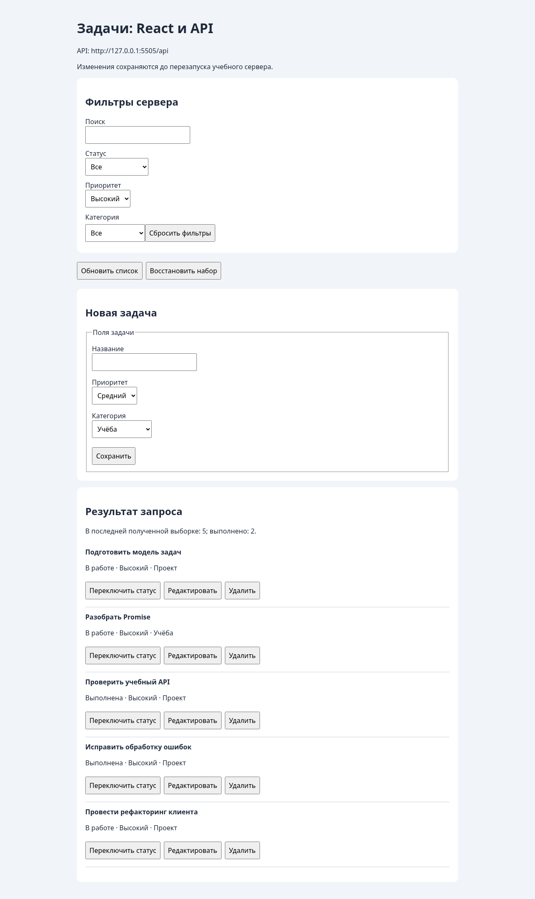

# Практическая работа №8. Работа React-приложения с API

**Студент:** Алешин Андрей Романович

**Группа:** ЭФБО-12-25

**Вариант:** 3, высокий приоритет.

## 1. Цель и результат

Связать интерфейс React с учебным HTTP API. Приложение получает задачи и категории с сервера, передаёт фильтры в query-параметрах, создаёт, редактирует, переключает статус и удаляет задачи. Реализован хук `useTaskData`; готовые сервер, HTTP-модули, компоненты и тесты взяты из starter ПР8.

При ошибке обновления сохраняется последний успешный снимок. Ненужные GET отменяются, старые ответы игнорируются. Повторное сохранение блокируется до завершения операции. Ошибка записи сохраняет черновик. После подтверждённой записи выполняется новый GET с актуальными фильтрами.

Данные хранятся в памяти процесса API. Перезагрузка страницы получает сохранённые задачи, а перезапуск сервера или восстановление набора возвращает исходные 12 записей. Базы данных и авторизации в этой работе нет.

## 2. Окружение и запуск

Проверено 15.11.2026, повторная финальная проверка — 16.11.2026. Окружение: Debian 13, Node.js 24.22.1, npm 11.9.0, Chromium 156.0.8078.79. Зависимости starter сохранены: React и React DOM 19.3.0, Vite 7.3.6, плагин React 5.2.0, jsdom 27.4.0. Новые зависимости не добавлялись.

Из папки `practice-08`:

```bash
npm ci
npm test
```

В первом терминале:

```bash
npm run api
```

Во втором терминале из той же папки:

```bash
npm run dev
```

Интерфейс: http://127.0.0.1:5173/. API: http://127.0.0.1:5505/api. Проверка API: http://127.0.0.1:5505/api/health, ожидается `{"data":{"status":"ok"}}`. Остановка каждого процесса — `Ctrl+C`. Перед запуском нужно освободить порт 5505 от серверов прошлых работ.

В облачной проверке стандартный каталог кеша npm был недоступен. Установка успешно выполнена командой `npm ci --cache /workspace/.npm-cache`. Это настройка проверочного окружения, менять lock-файл не потребовалось.

Для готовой сборки, пока API работает:

```bash
npm run build
npm run preview
```

Preview: http://127.0.0.1:4173/, точный адрес указан в терминале.

Другой порт API: `npm run api -- 5515`. В локальном `.env` по образцу `.env.example` указать `VITE_API_URL=http://127.0.0.1:5515/api`, затем перезапустить Vite; для preview пересобрать проект. При занятом порте интерфейса: `npm run dev -- --port 5174`.

Запросы идут к абсолютному адресу API, без proxy Vite. Сервер разрешает CORS, поэтому запросы работают и в dev, и в preview. `.env`, `node_modules` и `dist` исключены из Git; `.env.example` и `package-lock.json` входят в сдачу. В переменные `VITE_` нельзя помещать секреты: они попадают в клиентскую сборку.

## 3. Компоненты и архитектура

| Файл или компонент | За что отвечает |
|---|---|
| `src/main.jsx` | Подключает React к `root` и включает `StrictMode`. |
| `src/App.jsx` | Хранит фильтры, снимок редактируемой записи и сообщение. Подтверждает удаление и восстановление набора. |
| `TaskFilters` | Управляемые поля поиска, статуса, приоритета и категории; передаёт новый объект фильтров в `App`. |
| `TaskForm` | Хранит черновик, проверяет поля, ожидает `Promise<boolean>` от `onSave`. При `false` сохраняет поля, при `true` очищает создание; `App` завершает редактирование. |
| `TaskList` | Выводит серверную выборку и передаёт действия с выбранной задачей. Ключ карточки — `task.id`. |
| `src/hooks/useTaskData.js` | Загружает снимок, управляет состояниями запроса, отменой, ошибками, блокировкой и мутациями. |
| `src/config.js` | Создаёт один экземпляр API вне компонентов; его ссылка стабильна. |
| `src/task-api.js` | Предметные методы задач, проверка схем ответа, параллельная загрузка задач и категорий. |
| `src/api-client.js` | URL, query, JSON, HTTP-статусы, тайм-аут, отмена и `ApiError`. Ответ 204 превращает в `null`. |
| `api/server.mjs`, `api/data.js` | Готовый учебный сервер и исходные записи. |

В отличие от ПР7 клиент не назначает id, не добавляет задачи в локальный массив и не фильтрует серверный результат повторно. Источник задач — API. `meta.total` и число выполненных относятся к последней полученной выборке: при высоком фильтре сначала 5 задач, из них 2 выполнены, а не 12 задач всей системы.

`App` хранит объект редактируемой задачи отдельно от текущей выборки. Поэтому фильтр может скрыть карточку, но черновик формы сохранится. Ключ формы зависит от id: выбор другой задачи создаёт форму с её полями. PATCH формы содержит только `title`, `priority`, `categoryId`; поле `completed` меняется отдельной операцией.

## 4. Загрузка, cleanup и изменения

Состояние хука: `snapshot`, `status`, `error`, `mutationError`, `pending`, `revision`. Снимок содержит `tasks`, `categories`, `meta`. Начальный статус — `loading`; пустой успешный массив переводит его в `ready`, ошибка актуального чтения — в `error`.

Зависимости загрузки: `[api, q, completed, priority, categoryId, revision]`. Поля извлекаются из `filters`, поэтому новый объект с теми же значениями не вызывает лишний GET. `snapshot` — результат эффекта, его нет в зависимостях. `refresh()` функционально увеличивает `revision`.

Каждый эффект создаёт свой `AbortController` и `active = true`, сбрасывает ошибку чтения и сохраняет старый снимок до успеха. `loadInitialData` параллельно запрашивает задачи и категории. Cleanup сначала устанавливает `active = false`, затем отменяет запрос. Успех и ошибка старого эффекта не меняют состояние даже при игнорировании signal реализацией API. Отмена не выводится как ошибка пользователя.

Отдельный эффект отмечает монтирование через `mounted.current`. Setup заново устанавливает `true`, поэтому дополнительный цикл `StrictMode` работает корректно. При размонтировании отменяется и мутация. Смена фильтра отменяет только чтение.

Общая функция `mutate` проверяет монтирование и `mutationController.current`, сразу записывает новый контроллер в ref, включает `pending` и очищает `mutationError`. Ref блокирует второй синхронный вызов до нового рендера. В `finally` освобождается только контроллер своей операции, `pending` снимается только у смонтированного хука. Форма дополнительно защищена своим `submitting` ref.

`saveTask(null, value)` вызывает POST, `saveTask(id, value)` — PATCH; `toggleTask` передаёт только новый `completed`, `deleteTask` — DELETE, `resetData` — POST восстановления. Методы возвращают `true` после подтверждённого API успеха, иначе `false`. После успеха увеличивается `revision`, эффект загружает данные с текущими фильтрами.

Ошибка изменения (`mutationError`) и ошибка GET (`error`) независимы. Если POST успешен, а новый GET не удался, форма завершает сохранение, сообщение об успехе остаётся, рядом видна ошибка обновления. POST автоматически не повторяется. При потере ответа на запись её результат неизвестен: перед ручным повтором нужно обновить список. Отмена ожидания клиентом не откатывает изменение на сервере.

Пока идёт запись, чтение или показана ошибка GET, изменяющие элементы отключены. Фильтры и обновление остаются доступны. Ошибки формы связаны с полями через `aria-describedby` и `aria-invalid`; серверные ошибки видны через `role="alert"`.

## 5. Индивидуальный вариант 3

В `src/variant.js` установлено `variant = 3`. Начальные фильтры: `{ q: '', completed: '', priority: 'high', categoryId: '' }`. Пустые значения не попадают в URL, строка `'false'` при выборе статуса сохраняется.

| Действие | Метод и путь | Тело | Статус | Фактический результат в dev и preview |
|---|---|---|---:|---|
| Открыть исходный набор | `GET /api/tasks?priority=high` | — | 200 | Задачи `[4, 13, 16, 25, 34]`, `meta.total = 5`, выполнено 2. |
| Получить справочник | `GET /api/categories` | — | 200 | Категории 1 «Учёба», 2 «Проект», 3 «Организация». |
| Изменить приоритет задачи 4 | `PATCH /api/tasks/4` | `{"title":"Подготовить модель задач","priority":"medium","categoryId":2}` | 200 | Сервер подтвердил средний приоритет. `completed` не отправлялся. |
| Обновить тот же фильтр | `GET /api/tasks?priority=high` | — | 200 | Остались `[13, 16, 25, 34]`, `meta.total = 4`, выполнено 2. GET начался после PATCH. Категории также запрошены повторно. |
| Сбросить фильтры | `GET /api/tasks` | — | 200 | 12 задач, id 4 снова видна со средним приоритетом. |



[Состояние после PATCH и повторного GET](./screenshots/variant-after.png).

## 6. Тесты и сборка

Первый прогон ПР8 выполнен 15.11.2026. Все приведённые проверки повторены 16.11.2026 перед публикацией с теми же успешными итогами. Результаты прежних практик не пересчитывались.

| Команда | Ожидание | Фактически |
|---|---|---|
| `npm run check:api` в составе `npm test` | 23 успешных проверки | Успешно 23, ошибок 0. |
| `npm run check:integration` в составе `npm test` | 14 успешных проверок | Успешно 14, ошибок 0. |
| `npm run check:react` в составе `npm test` | 15 успешных проверок | tests 15, pass 15, fail 0. |
| `npm test` | Все 52 проверки | 52/52, exit 0. |
| `npm run build` | HTML, JS и CSS в `dist` | Сборка успешна, 38 модулей, exit 0. |
| `npm run preview` | Вариант, загрузка, создание и удаление | Приложение на 4173; вариант и полный CRUD прошли. |

[Вывод штатных тестов](./node-checks-output.txt). Тесты преподавателя не изменялись. API и интеграция используют отдельные серверы на свободных портах. React-набор проверяет настоящий React с jsdom и подставным API, включая старые ответы, StrictMode, unmount, двойную мутацию и смену фильтра во время записи.

## 7. Браузерный протокол

Сценарии ручного протокола методички воспроизведены автоматизацией Playwright в настоящем Chromium с настоящим локальным API. Это отдельная браузерная проверка, а не результат jsdom. Перед основным прогоном восстановлен набор и сброшены фильтры. Для медленной сети использована задержка 450 мс через CDP. В сценариях недоступности процесс API действительно останавливался и запускался заново.

| № | Сценарий | Ожидаемый результат | Фактически |
|---:|---|---|---|
| 1 | Открыть приложение | GET задач и категорий, после сброса 12 задач | 12 карточек, 3 категории, автоматического POST нет. |
| 2 | Открыть без API | Ошибка и доступный повтор | Ошибка загрузки, кнопка обновления доступна. |
| 3 | Запустить API и обновить | Данные и очищенная ошибка | Получены задачи и категории, ошибка исчезла. |
| 4 | Поиск без совпадений | Успех и пустая выборка | GET 200, 0 карточек и сообщение об отсутствии задач. |
| 5 | Быстро менять фильтры при задержке | Актуальный фильтр определяет результат | Старые GET отменены; high → low → high завершилось пятью высокими задачами. |
| 6 | Отправить пробелы | Ошибка, без POST | Сообщение у названия, `aria-invalid=true`, POST отсутствует. |
| 7 | Создать и перезагрузить | Задача останется | POST 201; «Сохранить React API» найдена после reload того же API. |
| 8 | Два быстрых сохранения | Одна запись | При 450 мс один POST и одна карточка, поля заблокированы на время записи. |
| 9 | Изменить выполненную | PATCH без completed, статус сохранён | id 1 изменилась, статус «Выполнена» остался. |
| 10 | Переключить статус под фильтром | PATCH → GET с теми же условиями | `completed=true`, затем GET `?completed=false`; id 4 исчезла. |
| 11 | Отказаться и подтвердить удаление | Запрос только при согласии | При отказе DELETE нет; при согласии DELETE 204, GET и исчезновение id 7. |
| 12 | Выключить API перед записью | Черновик остаётся, ошибка записи, блокировка снята | Все три поля сохранены; сообщение об ошибке изменения, сохранение снова доступно. |
| 13 | Обновить после потери связи | Старый снимок, ошибка, изменения отключены | Карточки сохранены, запись отключена, обновление доступно. |
| 14 | Скрыть редактируемую запись | Черновик и исходный id сохранены | Поле осталось; PATCH адресован `/api/tasks/4`, после сброса видно новое название. |
| 15 | Ввести `` | Буквальный текст | Строка видна, элемента img и вызова alert нет. |
| 16 | Перезапустить API | Исходные записи | Снова 12 задач, прежние изменения исчезли. |
| 17 | Вариант и CRUD в preview | Поведение как в dev | Пять высоких → четыре после PATCH; создание, правка, статус и удаление прошли. |

Дополнительный сценарий записи и чтения выполнен в preview: после загрузки заблокирован `GET /api/categories` через браузерный `route.abort`. POST вернул 201, осталось сообщение «Сохранено на сервере», появилась отдельная ошибка обновления. Форма очистилась, старые 12 карточек остались. После снятия блокировки и обновления получено 13 карточек, новая задача ровно одна. Это воспроизводит сетевую блокировку из методички средствами автоматизации; вручную через панель DevTools блокировка не настраивалась.

Также проверены 101 символ (ошибка без POST), 100 символов (создание), отправка Enter и ширина 390 px без горизонтальной прокрутки. Итого 20 успешных групп: 17 обязательных, отдельный вариант в dev и две дополнительные группы. Ошибок JavaScript не зарегистрировано. Console содержит ожидаемые ошибки связи при остановленном/заблокированном API и 404 необязательного `favicon.ico`.

[Фактический браузерный протокол и запросы варианта](./browser-checks-output.txt).

## 8. Контрольные вопросы

1. Эффект запускает синхронизацию с API после рендера. Запрос в теле компонента запускался бы при каждом рендере и мог создавать цикл запросов.
2. Cleanup вызывается перед новым запуском эффекта с изменёнными зависимостями и при размонтировании; в StrictMode есть дополнительный пробный цикл.
3. Callback эффекта возвращает cleanup или ничего. `async` вернул бы Promise, поэтому асинхронная функция объявлена внутри.
4. Нужны стабильный `api`, четыре значения фильтров и `revision`. `snapshot` является результатом загрузки, включение его вызвало бы новые GET после каждого успеха.
5. Новый объект API при каждом рендере менял бы зависимость эффекта и запускал лишнюю загрузку. В `config.js` объект создан один раз.
6. AbortController отменяет ожидание, но API может проигнорировать сигнал или вернуть результат поздно. `active` запрещает принимать такой ответ.
7. Старая ошибка также может прийти позже нового успеха и испортить экран. Поэтому актуальность проверяется и в `catch`.
8. StrictMode проверяет, что setup и cleanup можно безопасно выполнить повторно. Пробные GET отменяются, POST при монтировании не выполняется.
9. Обновление state применяется при следующем рендере; два синхронных обработчика могут видеть прежний `pending`. Ref меняется сразу и блокирует второй вызов.
10. `true` означает подтверждённый успех записи. Ошибка последующего GET хранится отдельно и не требует повторять POST.
11. После тайм-аута сервер мог уже выполнить POST. Автоматический повтор может создать дубликат; сначала нужно проверить список.
12. Фильтры меняют чтение, а пользовательская запись должна завершиться независимо. Поэтому у чтения и записи разные контроллеры.
13. Отмена клиентского ожидания не является откатом. Сервер мог выполнить операцию до отмены; без ответа результат нужно уточнить.
14. `meta.total` — размер отфильтрованного ответа. Например, в начале варианта он равен 5, хотя на сервере 12 задач.
15. jsdom не проверяет браузерный CORS, реальную сеть, внешний вид, нативное подтверждение, клавиатуру и готовую сборку. Для них нужен браузерный прогон.

## 9. Вывод

Освоена загрузка API через эффект React с очисткой, защитой от гонок и независимыми результатами чтения и записи. Вариант показывает, что после смены приоритета серверная выборка обновляется через PATCH → GET. При замене учебного сервера нужно сохранить контракт методов, настроить адрес и CORS; для сохранности данных между перезапусками понадобится серверное постоянное хранилище.

Методичка и starter: [ПР8 преподавателя, версия 37fd64e](https://github.com/adyshkins/TIP-JS/tree/37fd64e6f09e728e60e6304d50eda07c398bbd1c/practices/practice-08). Предыдущие практические работы сохранены.
